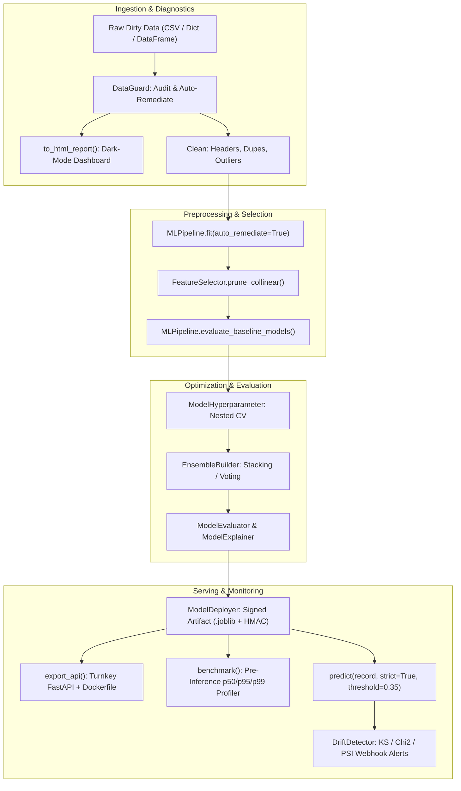

# Serverlex: The Complete Technical Manual & API Reference (v1.3.0)

**The Production-Safe Machine Learning Preprocessing, Diagnostics, & Serving Platform**

---

## Table of Contents

1. [Architecture & Design Principles](#1-architecture--design-principles)
2. [Module 1: `serverlex.diagnostics.dataguard.DataGuard`](#2-dataguard--pre-flight-health--leakage-audit)
3. [Module 2: `serverlex.preprocessing.clean.Clean`](#3-clean--data-sanitization--outlier-engine)
4. [Module 3: `serverlex.visualization.eda.Visualize`](#4-visualize--server-safe-eda--live-cleaning)
5. [Module 4: `serverlex.preprocessing.pipeline.MLPipeline`](#5-mlpipeline--leakage-free-preprocessing--benchmarks)
6. [Module 5: `serverlex.modeling.selector.FeatureSelector`](#6-featureselector--mutual-information--collinearity-pruning)
7. [Module 6: `serverlex.modeling.hyperparameter.ModelHyperparameter`](#7-modelhyperparameter--nested-vs-non-nested-tuning)
8. [Module 7: `serverlex.modeling.ensemble.EnsembleBuilder`](#8-ensemblebuilder--voting--stacking-ensembles)
9. [Module 8: `serverlex.diagnostics.evaluation.ModelEvaluator`](#9-modelevaluator--multi-task-diagnostics--curves)
10. [Module 9: `serverlex.diagnostics.explainability.ModelExplainer`](#10-modelexplainer--global-feature-importances)
11. [Module 10: `serverlex.serving.deployer.ModelDeployer`](#11-modeldeployer--signed-serving-api-export--benchmarking)
12. [Module 11: `serverlex.diagnostics.drift.DriftDetector`](#12-driftdetector--population-drift-monitoring--webhooks)
13. [Complete End-to-End Master Tutorial](#13-complete-end-to-end-master-tutorial)
14. [Production Best Practices & Troubleshooting](#14-production-best-practices--troubleshooting)

---

## 1. Architecture & Design Principles

Serverlex is built to eliminate the primary causes of failure in production machine learning systems:
1. **Target Leakage**: Future or proxy features corrupting the training split.
2. **Train/Serve Skew**: Differences in data cleaning, encoding, or scaling between training and inference environments.
3. **Mismatched Schema & Dimensionality Collapse**: Novel categories or missing levels in inference payloads crashing models with `ValueError: expected 15 features, got 14`.
4. **Untrusted Deserialization**: Insecure unpickling of model artifacts without cryptographic verification.
5. **Silent Production Distribution Drift**: Unmonitored changes in incoming production feature distributions causing silent degradation.



---

## 2. `DataGuard` — Pre-Flight Health & Leakage Audit

**Module**: `serverlex.diagnostics.dataguard`  
**Class**: `DataGuard(df=None, target=None)`

### Overview
`DataGuard` runs pre-flight diagnostic audits on raw tabular datasets before any cleaning or model training begins. It automatically strips embedded headers, catches target leakage proxies, flags unique identifiers, differentiates PII from datetimes, detects infinite numbers, identifies collinear feature pairs, and generates standalone HTML audit dashboards.

### Constructor Parameters
| Parameter | Type | Default | Description |
|---|---|---|---|
| `df` | `pd.DataFrame` or `None` | `None` | Raw input dataset. Embedded header rows are stripped automatically during instantiation. |
| `target` | `str` or `None` | `None` | Name of the target variable/column. |

### Instance Attributes
- `data`: Cleaned copy of the dataset (header duplicates removed).
- `warnings`: List of check dictionaries containing `Check`, `Status` (`PASS`, `WARN`, `FAIL`), `Details`, and `Fix`.
- `id_cols`: List of detected unique identifier columns.
- `pii_cols`: List of detected Personally Identifiable Information columns.
- `leakage_cols`: List of `(col_name, correlation)` tuples flagged for target leakage.
- `high_cardinality_cols`: List of categorical columns with high distinct counts.
- `collinear_pairs`: List of `(col_a, col_b, r)` tuples exceeding collinearity thresholds.

### Methods

#### `set_data(df)`
Updates the internal dataset and resets warning states.

#### `check_id_columns(threshold=0.95)`
* **Description**: Flags columns with uniqueness ratio $\ge 0.95$ combined with ID naming patterns (`id`, `uuid`, `key`, `ssn`, `index`), or 100% unique object columns.
* **Returns**: `list[str]` of detected ID columns.

#### `check_target_leakage(target=None, threshold=0.90)`
* **Description**: Coerces numeric-majority string columns (e.g. `"$1,200"`, `"0.994"`) and computes Pearson correlation matrix against the target. Features with $|r| \ge \text{threshold}$ are flagged as critical target leakage candidates.
* **Returns**: `list[tuple[str, float]]` containing `(feature_name, abs_correlation)`.

#### `check_class_imbalance(target=None)`
* **Description**: Evaluates discrete target frequency distributions. Flags warning if the minority class comprises $< 10\%$ of observations.
* **Returns**: `None` (appends to `warnings`).

#### `check_cardinality(threshold=100)`
* **Description**: Scans categorical and text columns. Differentiates:
  - **PII Columns**: Matches `name`, `fullname`, `firstname`, `lastname`, `email`, `phone`, `address`, `ssn`.
  - **Datetime Series**: Matches `date`, `time`, `timestamp`, `dob` or $\ge 70\%$ valid date parse rate.
  - **High Cardinality**: True categorical levels $> 100$.
* **Returns**: `list[tuple[str, int]]` of high cardinality columns.

#### `check_infinite_values()`
* **Description**: Scans numerical columns for `+np.inf` or `-np.inf`.
* **Returns**: `list[tuple[str, int]]` containing `(column, inf_count)`.

#### `check_collinearity(threshold=0.85)`
* **Description**: Computes pairwise Pearson correlation across all numerical features (excluding target). Flags pairs with $|r| \ge \text{threshold}$.
* **Returns**: `list[tuple[str, str, float]]` containing `(col_a, col_b, correlation)`.

#### `run_audit(target=None, leakage_threshold=0.90, id_threshold=0.95, cardinality_threshold=100, collinearity_threshold=0.90)`
* **Description**: Orchestrates all pre-flight diagnostic checks.
* **Returns**: `pd.DataFrame` containing the structured audit report with columns `['Check', 'Status', 'Details', 'Fix']`.

#### `auto_remediate(target=None, drop_ids=True, drop_pii=True, drop_leakage=True, drop_collinear=False, leakage_threshold=0.90, id_threshold=0.95, collinearity_threshold=0.90)`
* **Description**: Automatically cleans and prunes raw data based on audit findings.
* **Returns**: `tuple[pd.DataFrame, dict]`
  - `clean_df`: Sanitized DataFrame ready for pipeline modeling.
  - `summary`: Detailed dictionary of all dropped columns and initial vs. remaining counts.

#### `to_html_report(filepath=None, title="Serverlex Data Health & Quality Audit")`
* **Description**: Exports a self-contained, offline, dark-themed HTML report with an overall Health Score (0-100, A+ to F), summary stat cards, audit check tables, and column directory.
* **Returns**: `str` of the HTML content. Also writes to `filepath` if provided.

### Complete Code Example
```python
import pandas as pd
from serverlex import DataGuard

df = pd.read_csv("raw_customers.csv")
guard = DataGuard(df, target="churn")

# 1. Run full diagnostic audit
audit_df = guard.run_audit(leakage_threshold=0.90, collinearity_threshold=0.85)
print(audit_df)

# 2. Export interactive HTML report
guard.to_html_report("reports/data_health.html", title="Customer Data Quality Audit")

# 3. Automatically remediate dirty data
clean_df, summary = guard.auto_remediate(drop_ids=True, drop_pii=True, drop_leakage=True)
print("Columns dropped:", summary["dropped_columns"])
```

---

## 3. `Clean` — Data Sanitization & Outlier Engine

**Module**: `serverlex.preprocessing.clean`  
**Class**: `Clean(path_or_df)`

### Overview
`Clean` handles low-level data sanitation: dropping embedded header rows, trimming whitespace, standardizing column names, coercing strings with units/currencies into floats, cell-wise outlier clipping (with target and binary protection), deduplication, and missing value imputation.

### Constructor Parameters
| Parameter | Type | Default | Description |
|---|---|---|---|
| `path_or_df` | `str` or `pd.DataFrame` | *Required* | Filepath to CSV or an existing pandas DataFrame. |

### Instance Attributes
- `data`: Internal working DataFrame.
- `numerical_columns`: DataFrame subset containing numeric columns.
- `categorical_columns`: DataFrame subset containing object/categorical columns.

### Methods

#### `drop_embedded_headers()`
* **Description**: Detects and drops rows created by accidental CSV concatenation where row values match column header names.
* **Returns**: `pd.DataFrame`.

#### `clean_column_names()`
* **Description**: Converts column names to lowercase, strips leading/trailing spaces, replaces inner spaces with underscores, and strips non-word characters.
* **Returns**: `pd.DataFrame`.

#### `clean_numeric_strings(columns=None)`
* **Description**: Strips currency symbols (`$`, `₹`, `€`, `£`, `¥`), unit suffixes (`GB`, `MB`, `kg`, `lbs`, `%`), and converts commas to dots, coercing values to `float64`.
* **Returns**: `pd.DataFrame`.

#### `delete_duplicates(subset=None)`
* **Description**: Removes duplicate rows while preserving the first instance.
* **Returns**: `pd.DataFrame`.

#### `outliers_IQR(param='m', exclude_columns=None, corr_target=None)`
* **Description**: Computes interquartile range ($IQR = Q_3 - Q_1$).
  - Bounds: $[Q_1 - 1.5 \cdot IQR, \; Q_3 + 1.5 \cdot IQR]$.
  - `param='m'`: Caps outliers at mean.
  - `param='median'`: Caps outliers at median.
  - `param='r'`: Drops rows with outliers.
  - Automatically preserves binary columns (0/1), class targets (`corr_target`), and degenerate discrete columns where $IQR = 0$.
* **Returns**: `pd.DataFrame`.

#### `outliers_Z(param='m', threshold=3, exclude_columns=None, corr_target=None)`
* **Description**: Computes standard score $z = \frac{x - \mu}{\sigma}$ and mitigates observations where $|z| > \text{threshold}$.
* **Returns**: `pd.DataFrame`.

#### `total_clean(...)`
* **Description**: Executes the complete sanitation chain in mathematically optimal order:
  1. `drop_embedded_headers()`
  2. `clean_column_names()`
  3. `clean_numeric_strings()`
  4. Datetime parsing
  5. `delete_duplicates()`
  6. Missing value imputation
  7. Outlier mitigation with target protection
* **Parameters**:
  - `data_time`: `list[str]`, e.g. `["signup_date", "%Y-%m-%d"]`.
  - `numeric_string_cols`: `list[str]`, columns to strip units/symbols from.
  - `missing_param`: `'m'` (mean/mode), `'median'`, or `'r'` (drop rows).
  - `outlier_method`: `'IQR'` or `'Z'`.
  - `outlier_param`: `'m'`, `'median'`, or `'r'`.
  - `exclude_outliers`: `list[str]`, columns exempted from clipping.
  - `corr_target`: `str`, target column exempted from clipping.
  - `null_threshold`: `float`, drop columns with missing ratio $> \text{threshold}$ (default 0.70).
* **Returns**: Cleaned `pd.DataFrame`.

### Complete Code Example
```python
from serverlex import Clean

cleaner = Clean("messy_customers.csv")
clean_df = cleaner.total_clean(
    data_time=["Signup Date", "%Y-%m-%d"],
    numeric_string_cols=["Monthly Fee", "Usage GB"],
    outlier_method="IQR",
    outlier_param="median",
    exclude_outliers=["usage_gb"],
    corr_target="churn"
)
```

---

## 4. `Visualize` — Server-Safe EDA & Live Cleaning

**Module**: `serverlex.visualization.eda`  
**Class**: `Visualize(data)`

### Overview
`Visualize` provides headless-safe Exploratory Data Analysis (EDA) plotting utilities. All plot functions accept an optional `save_path` parameter that saves the figure to disk using non-interactive backends (`Agg`), preventing server process hangs. It also features `live_clean()` for dynamic interactive before-and-after animations.

### Constructor Parameters
| Parameter | Type | Default | Description |
|---|---|---|---|
| `data` | `str` or `pd.DataFrame` | *Required* | Filepath to CSV or existing DataFrame. |

### Methods

#### `plot_missing(save_path=None)`
* **Description**: Generates a bar plot of missing cell counts and percentages per column.
* **Returns**: `matplotlib.figure.Figure`.

#### `plot_distribution(column=None, save_path=None)`
* **Description**: Renders distribution histograms with KDE curves for numerical features.
* **Returns**: `matplotlib.figure.Figure`.

#### `plot_box(columns=None, save_path=None)`
* **Description**: Renders box plots to inspect quartile distributions and extreme outliers.
* **Returns**: `matplotlib.figure.Figure`.

#### `plot_categorical(column=None, top_n=10, save_path=None)`
* **Description**: Generates bar charts of category frequency counts for discrete features.
* **Returns**: `matplotlib.figure.Figure`.

#### `plot_correlation(save_path=None)`
* **Description**: Renders an annotated Pearson correlation matrix heatmap across numerical columns.
* **Returns**: `matplotlib.figure.Figure`.

#### `live_clean(pause_time=1.5)`
* **Description**: Enables Matplotlib interactive mode (`plt.ion()`) and renders live, animated plot transitions showing distributions before and after each cleaning stage.

### Complete Code Example
```python
from serverlex import Visualize

vis = Visualize("data.csv")
vis.plot_missing(save_path="plots/missing.png")
vis.plot_distribution(column="age", save_path="plots/age_dist.png")
vis.plot_box(columns=["usage_gb", "monthly_fee"], save_path="plots/box.png")
vis.plot_correlation(save_path="plots/corr_heatmap.png")
```

---

## 5. `MLPipeline` — Leakage-Free Preprocessing & Benchmarks

**Module**: `serverlex.preprocessing.pipeline`  
**Class**: `MLPipeline(data=None)`

### Overview
`MLPipeline` strictly separates statistical learning (`fit`) from execution (`transform`). All imputation statistics (means, medians, modes), one-hot category dictionaries, and scaler parameters are memorized during `fit()` and locked during inference. It handles automatic numeric string coercion, ID column exclusion, PII/leakage auto-remediation, datetime feature expansion, and zero-leakage baseline model benchmarking.

### Constructor Parameters
| Parameter | Type | Default | Description |
|---|---|---|---|
| `data` | `str`, `Clean`, `pd.DataFrame`, or `None` | `None` | Optional initial dataset. |

### Instance Attributes
- `feature_columns`: Final ordered list of feature names.
- `num_fill`: Dictionary of `{column: mean_value}` memorized for numeric imputation.
- `cat_fill`: Dictionary of `{column: mode_value}` memorized for categorical imputation.
- `cat_categories`: Dictionary of `{column: list_of_categories}` memorized for one-hot encoding.
- `scaler_mean`, `scaler_std`: Standard scaling parameters.
- `scaler_min`, `scaler_max`: MinMax scaling parameters.
- `scaler_median`, `scaler_iqr`: Robust scaling parameters.
- `id_cols`: ID columns excluded from encoding.
- `remediated_cols`: Full list of dropped ID, PII, and leakage columns.
- `date_col`: Expanded datetime feature column name.
- `X_train`, `y_train`: Transformed training feature matrix and target vector.

### Methods

#### `fit(df, target=None, encode='onehot', scale='standard', data_time=None, numeric_string_cols=None, drop_id_cols=True, id_cols=None, auto_remediate=False, drop_leakage=False, leakage_threshold=0.90, drop_pii=False, **kwargs)`
* **Description**: Fits preprocessing transformations strictly on training data.
* **Parameters**:
  - `df`: Training DataFrame.
  - `target`: Target variable name.
  - `encode`: `'onehot'`, `'label'`, or `None`.
  - `scale`: `'standard'`, `'minmax'`, `'robust'`, or `None`.
  - `data_time`: `list[str]`, e.g. `["signup_date", "%Y-%m-%d"]`. Expands into `_year`, `_month`, `_day`, `_dayofweek`.
  - `numeric_string_cols`: Explicit numeric string columns to parse. Predominantly numeric string columns ($\ge 70\%$) are auto-detected.
  - `drop_id_cols`: Automatically detect and exclude ID columns (default `True`).
  - `auto_remediate`: Automatically drop ID columns, PII, and target leakage features ($r \ge \text{leakage_threshold}$).
  - `drop_leakage`: Explicitly drop target leakage features.
  - `drop_pii`: Explicitly drop PII columns.
* **Returns**: `self`.

#### `transform(df)`
* **Description**: Transforms new test sets, micro-batches, or raw single-record dicts using memorized statistics. Automatically reindexes columns to `self.feature_columns` with fill value 0.
* **Parameters**:
  - `df`: `pd.DataFrame`, `dict`, or `list[dict]`.
* **Returns**:
  - `X` (`pd.DataFrame`) if target is absent.
  - `(X, y)` (`tuple[pd.DataFrame, pd.Series]`) if target is present.

#### `fit_transform(df, **kwargs)`
* **Description**: Executes `fit(df, **kwargs)` and returns transformed `(X_train, y_train)` or `X_train`.

#### `add_model(name, model)`
* **Description**: Registers custom scikit-learn compatible estimators (e.g. LightGBM, XGBoost, CatBoost) into the baseline benchmarking suite.
* **Returns**: `self`.

#### `evaluate_baseline_models(X=None, y=None, cv=5)`
* **Description**: Auto-detects task (Classification vs. Regression) and evaluates baseline algorithms (Random Forest, Gradient Boosting, Decision Tree, Logistic/Ridge Regression, plus custom registered models) using Stratified K-Fold or K-Fold cross-validation.
* **Returns**: `pd.DataFrame` leaderboard sorted by performance.

### Complete Code Example
```python
from serverlex import MLPipeline
from sklearn.neighbors import KNeighborsClassifier

train_df = pd.read_csv("train.csv")
test_df = pd.read_csv("test.csv")

pipeline = MLPipeline()
pipeline.add_model("KNN", KNeighborsClassifier(n_neighbors=5))

# Fit with auto-remediation (drops IDs, PII, and leaked columns automatically)
pipeline.fit(
    train_df,
    target="churn",
    encode="onehot",
    scale="standard",
    data_time=["signup_date"],
    auto_remediate=True
)

X_train, y_train = pipeline.transform(train_df)
X_test, y_test = pipeline.transform(test_df)

leaderboard = pipeline.evaluate_baseline_models(cv=5)
print(leaderboard)
```

---

## 6. `FeatureSelector` — Mutual Information & Collinearity Pruning

**Module**: `serverlex.modeling.selector`  
**Class**: `FeatureSelector(k=10, variance_threshold=0.01, corr_threshold=0.90)`

### Overview
`FeatureSelector` reduces dimensional complexity and eliminates noise features via a three-tier cascade:
1. Low-variance pruning ($s^2 \le \text{variance\_threshold}$).
2. Pairwise collinearity pruning ($|r| > \text{corr\_threshold}$).
3. Non-linear Mutual Information ranking:
   $$I(X; Y) = \sum_{x, y} p(x, y) \log \frac{p(x, y)}{p(x)p(y)}$$

### Methods

#### `fit(X, y)`
* **Description**: Computes variance thresholds, identifies collinear duplicates, and calculates Mutual Information scores with target `y`. Selects the top $K$ features.
* **Returns**: `self`.

#### `transform(X)`
* **Description**: Filters input DataFrame to the top $K$ selected features.
* **Returns**: `pd.DataFrame`.

#### `fit_transform(X, y)`
* **Description**: Fits on `(X, y)` and returns transformed feature matrix.

#### `get_ranked_scores()`
* **Description**: Returns DataFrame of all features ranked by Mutual Information score.

#### `prune_collinear(X, threshold=0.85, y=None)` *(Static Method)*
* **Description**: Standalone utility that identifies collinear feature pairs ($|r| \ge \text{threshold}$). If target `y` is provided, automatically retains the feature with higher correlation/mutual information with `y` and drops the redundant partner.
* **Returns**: `tuple[pd.DataFrame, list[str]]` containing `(pruned_df, dropped_columns)`.

### Complete Code Example
```python
from serverlex import FeatureSelector

# 1. Standalone collinearity pruning
pruned_X, dropped_cols = FeatureSelector.prune_collinear(X_train, threshold=0.85, y=y_train)
print("Dropped collinear features:", dropped_cols)

# 2. Select Top K Features via Mutual Information
selector = FeatureSelector(k=8, corr_threshold=0.90)
X_train_k = selector.fit_transform(pruned_X, y_train)
X_test_k = selector.transform(X_test)
print(selector.get_ranked_scores())
```

---

## 7. `ModelHyperparameter` — Nested vs. Non-Nested Tuning

**Module**: `serverlex.modeling.hyperparameter`  
**Class**: `ModelHyperparameter()`

### Overview
Addresses optimistic performance bias in standard hyperparameter tuning. While standard `GridSearchCV` optimizes parameters for final production deployment, **Nested Cross-Validation** provides a mathematically unbiased estimate of generalization error by separating parameter optimization (inner loop) from model evaluation (outer holdout loop).

```
Outer Loop (Generalization Evaluation): Fold 1 [Test] | Fold 2 [Train] | Fold 3 [Train]
      └── Inner Loop (Hyperparameter Tuning): Fold 2a [Val] | Fold 2b [Train]
```

### Methods

#### `get_default_param_grid(model_name)`
* **Description**: Returns pre-built search grids for algorithms:
  - `"random_forest"`: `n_estimators`, `max_depth`, `min_samples_split`.
  - `"gradient_boosting"`: `learning_rate`, `n_estimators`, `max_depth`.
  - `"decision_tree"`: `max_depth`, `min_samples_split`.
  - `"logistic_regression"`: `C`, `penalty`, `solver`.
  - `"ridge"`: `alpha`.
* **Returns**: `dict`.

#### `tune_non_nested(estimator, param_grid, X, y, cv=5, scoring=None)`
* **Description**: Standard `GridSearchCV` optimizing parameters across all folds. Used to train the **final production model artifact**.
* **Returns**: `dict` containing `{"best_estimator", "best_params", "best_score", "cv_results"}`.

#### `tune_nested_cv(estimator, param_grid, X, y, outer_cv=5, inner_cv=3, scoring=None)`
* **Description**: Executes nested cross-validation. Reports unbiased generalization score and fits a final estimator on all data using the best parameters.
* **Returns**: `dict` containing `{"nested_scores", "nested_mean", "nested_std", "best_estimator", "best_params"}`.

#### `compare_nested_vs_non_nested(estimator, param_grid, X, y, outer_cv=5, inner_cv=3, scoring=None)`
* **Description**: Runs nested and non-nested tuning side-by-side, reporting the degree of optimistic validation bias:
  $$\text{Bias} = \text{Non-Nested Score} - \text{Nested Mean}$$
* **Returns**: `dict` summary.

### Complete Code Example
```python
from serverlex import ModelHyperparameter
from sklearn.ensemble import RandomForestClassifier

tuner = ModelHyperparameter()
grid = tuner.get_default_param_grid("random_forest")

res = tuner.tune_nested_cv(
    estimator=RandomForestClassifier(random_state=42),
    param_grid=grid,
    X=X_train,
    y=y_train,
    outer_cv=5,
    inner_cv=3
)

print(f"Unbiased Generalization Accuracy: {res['nested_mean']:.4f} +/- {res['nested_std']:.4f}")
final_production_model = res["best_estimator"]
```

---

## 8. `EnsembleBuilder` — Voting & Stacking Ensembles

**Module**: `serverlex.modeling.ensemble`  
**Class**: `EnsembleBuilder(task="classification")`

### Overview
Combines diverse estimator families to reduce model variance and bias:
- **Soft Voting**: Computes probability averages across base estimators:
  $$\hat{y} = \arg\max_c \frac{1}{M} \sum_{m=1}^M P_m(y = c \mid X)$$
- **Stacking**: Trains base models using cross-validation out-of-fold predictions as meta-features for a secondary meta-learner (e.g. `LogisticRegression` or `RidgeCV`).

### Methods

#### `build_voting_ensemble(estimators, voting="soft", weights=None)`
* **Description**: Constructs a Voting ensemble (`VotingClassifier` or `VotingRegressor`).
* **Returns**: Scikit-learn Voting estimator.

#### `build_stacking_ensemble(estimators, final_estimator=None, cv=5)`
* **Description**: Constructs a Stacking ensemble (`StackingClassifier` or `StackingRegressor`) using out-of-fold meta-features.
* **Returns**: Scikit-learn Stacking estimator.

#### `evaluate_ensemble(ensemble, X, y, cv=5)`
* **Description**: Cross-validates the ensemble and returns mean score and standard deviation.
* **Returns**: `dict`.

### Complete Code Example
```python
from serverlex import EnsembleBuilder
from sklearn.ensemble import RandomForestClassifier, GradientBoostingClassifier
from sklearn.linear_model import LogisticRegression

builder = EnsembleBuilder(task="classification")
base_models = [
    ("rf", RandomForestClassifier(n_estimators=50, random_state=42)),
    ("gb", GradientBoostingClassifier(n_estimators=50, random_state=42)),
    ("lr", LogisticRegression(max_iter=1000))
]

# Stacking with logistic regression meta-learner
stack_model = builder.build_stacking_ensemble(base_models, cv=5)
stack_model.fit(X_train, y_train)

eval_res = builder.evaluate_ensemble(stack_model, X_train, y_train, cv=5)
print("Stacking CV Score:", eval_res["mean_score"])
```

---

## 9. `ModelEvaluator` — Multi-Task Diagnostics & Curves

**Module**: `serverlex.diagnostics.evaluation`  
**Class**: `ModelEvaluator()`

### Overview
Provides model diagnostic evaluations. Automatically detects classification vs. regression tasks, computes comprehensive metrics dictionaries, and renders headless-safe plots (`save_path`).

### Methods

#### `evaluate(model, X, y)`
* **Description**: Evaluates model against test data.
  - **Classification**: Returns `accuracy`, `precision_weighted`, `recall_weighted`, `f1_weighted`, `f1_macro`, and `roc_auc` (when `predict_proba` is supported).
  - **Regression**: Returns `mse`, `rmse`, `mae`, and `r2`.
* **Returns**: `dict` of metric names and float values.

#### `plot_confusion_matrix(y_true, y_pred, labels=None, save_path=None)`
* **Description**: Renders annotated confusion matrix showing True Positives, False Positives, True Negatives, and False Negatives.

#### `plot_roc_curve(y_true, y_prob, save_path=None)`
* **Description**: Renders Receiver Operating Characteristic (ROC) curve with Area Under the Curve (AUC). Supports binary and OvR multiclass.

#### `plot_precision_recall_curve(y_true, y_prob, save_path=None)`
* **Description**: Renders Precision-Recall curve, critical for imbalanced target evaluations.

#### `plot_actual_vs_predicted(y_true, y_pred, save_path=None)`
* **Description**: For regression: scatter plot with $y = x$ reference line.

#### `plot_residuals(y_true, y_pred, save_path=None)`
* **Description**: For regression: residual scatter plot and error distribution histogram to verify homoscedasticity.

### Complete Code Example
```python
from serverlex import ModelEvaluator

evaluator = ModelEvaluator()
metrics = evaluator.evaluate(final_production_model, X_test, y_test)
print("Test Metrics:", metrics)

evaluator.plot_confusion_matrix(y_test, final_production_model.predict(X_test), save_path="reports/cm.png")
evaluator.plot_roc_curve(y_test, final_production_model.predict_proba(X_test), save_path="reports/roc.png")
```

---

## 10. `ModelExplainer` — Global Feature Importances

**Module**: `serverlex.diagnostics.explainability`  
**Class**: `ModelExplainer(model, feature_names=None)`

### Overview
Extracts feature importance rankings:
1. **Model-Native Importances**: MDI (Mean Decrease in Impurity) for tree ensembles or linear coefficients for generalized linear models.
2. **Permutation Feature Importance**: Model-agnostic measurement:
   $$I(f) = \text{Metric}_{\text{baseline}} - \text{Metric}_{\text{shuffled}(f)}$$

### Methods

#### `get_feature_importances()`
* **Description**: Returns DataFrame of all features sorted by importance.
* **Returns**: `pd.DataFrame` with columns `['Feature', 'Importance']`.

#### `compute_permutation_importance(X, y, n_repeats=10, random_state=42)`
* **Description**: Calculates model-agnostic permutation importance on holdout sets.
* **Returns**: `pd.DataFrame` with columns `['Feature', 'Permutation_Importance_Mean', 'Permutation_Importance_Std']`.

#### `plot_feature_importance(top_n=10, save_path=None, title="Top Feature Importances")`
* **Description**: Renders horizontal bar chart of top drivers.

### Complete Code Example
```python
from serverlex import ModelExplainer

explainer = ModelExplainer(final_production_model, feature_names=pipeline.feature_columns)
print(explainer.get_feature_importances().head(10))

explainer.plot_feature_importance(top_n=10, save_path="reports/feature_importance.png")
```

---

## 11. `ModelDeployer` — Signed Serving, API Export, & Benchmarking

**Module**: `serverlex.serving.deployer`  
**Class**: `ModelDeployer(pipeline=None, model=None, metadata=None)`

### Overview
`ModelDeployer` is the production serving engine of Serverlex:
- Serializes fitted `MLPipeline` + trained model into a single `.joblib` artifact.
- Signs artifacts cryptographically using SHA-256 sidecars or HMAC-SHA256 signatures to prevent untrusted code execution.
- Predicts directly on raw inputs (single `dict`, micro-batch, or DataFrame) with automatic schema normalization and datetime expansion.
- Exports turnkey FastAPI production microservices with Dockerfiles.
- Profiles inference latency (p50, p90, p95, p99) and throughput.

### Constructor Parameters
| Parameter | Type | Default | Description |
|---|---|---|---|
| `pipeline` | `MLPipeline` | `None` | Fitted preprocessing pipeline. |
| `model` | Scikit-learn Estimator | `None` | Trained machine learning model. |
| `metadata` | `dict` | `None` | Optional deployment metadata (training date, metrics, author). |

### Methods

#### `save(filepath="model_bundle.joblib", compute_hash=True, hmac_key=None)`
* **Description**: Bundles and saves pipeline, model, and metadata.
  - If `compute_hash=True`: Writes a companion SHA-256 sidecar file (`.sha256`).
  - If `hmac_key`: Writes a cryptographic HMAC-SHA256 signature file (`.hmac`).

#### `load(filepath="model_bundle.joblib", verify_hash=None, hmac_key=None)` *(Class or Instance Method)*
* **Description**: Verifies cryptographic authenticity before deserialization. Raises `ValueError` on tamper detection.
* **Returns**: Instantiated `ModelDeployer`.

#### `predict(raw_input, strict=False, threshold=None)`
* **Description**: Serves predictions on raw JSON payloads.
  - Normalizes keys (`"Monthly Fee"` $\to$ `monthly_fee`).
  - Expands datetimes (`"2026-04-01"` $\to$ `year`, `month`, `day`, `dayofweek`).
  - Imputes missing features using memorized pipeline statistics.
  - Aligns columns with zero risk of shape mismatch.
  - `strict=True`: Raises `ValueError` if non-numeric values are passed to numeric columns or unseen categories appear.
  - `threshold=float`: Applies custom decision boundary for binary classification (e.g. `threshold=0.35`).
* **Returns**: `np.ndarray` predictions.

#### `predict_proba(raw_input, strict=False)`
* **Description**: Returns class probability distributions for classification models.
* **Returns**: `np.ndarray` of shape `(n_samples, n_classes)`.

#### `benchmark(sample=None, n_iterations=300, warmup=30)`
* **Description**: Executes pre-inference latency and SLA profiling.
* **Returns**: `dict` containing:
  - `p50_ms`, `p90_ms`, `p95_ms`, `p99_ms` latency percentiles.
  - `min_ms`, `max_ms`, `mean_ms`.
  - `throughput_req_per_sec`.

#### `export_api(output_dir="./serving_app", bundle_filename="model_bundle.joblib", hmac_key=None, host="0.0.0.0", port=8000)`
* **Description**: Exports a turnkey FastAPI microservice package to `output_dir`.
  - `app.py`: REST API with `/health`, `/schema`, `/predict`, `/benchmark`.
  - `Dockerfile`: Minimal Python 3.11 container.
  - `requirements.txt`: Lightweight serving requirements.
  - `README.md`: Run and docker build instructions.
* **Returns**: `dict` of created filepaths.

### Complete Code Example
```python
from serverlex import ModelDeployer

deployer = ModelDeployer(pipeline=pipeline, model=final_production_model)

# 1. Cryptographically sign and save
deployer.save("churn_service.joblib", hmac_key="secret_enterprise_key")

# 2. Benchmark SLA latency
sla = deployer.benchmark(n_iterations=500)
print(f"p50: {sla['p50_ms']}ms | p95: {sla['p95_ms']}ms | Throughput: {sla['throughput_req_per_sec']} req/s")

# 3. Export turnkey FastAPI microservice and Dockerfile
deployer.export_api(output_dir="./deploy_churn", hmac_key="secret_enterprise_key")

# 4. In Production API: Load and predict on raw payload
live_deployer = ModelDeployer.load("churn_service.joblib", hmac_key="secret_enterprise_key")
raw_payload = {
    "Signup Date": "2025-06-15",
    "Monthly Fee": "$65.00",
    "Usage GB": "14.2 GB",
    "Device": "Mobile"
}
pred = live_deployer.predict(raw_payload, threshold=0.30)
print("Predicted Churn:", pred[0])
```

---

## 12. `DriftDetector` — Population Drift Monitoring & Webhooks

**Module**: `serverlex.diagnostics.drift`  
**Class**: `DriftDetector(reference_data, alpha=0.01, psi_threshold=0.2)`

### Overview
Monitors live production batches for covariate shift ($P_{\text{train}}(X) \neq P_{\text{prod}}(X)$). Combines two-sample Kolmogorov-Smirnov tests, Chi-Square contingency testing, Wasserstein distance, and finite-sample corrected Population Stability Index (PSI):
$$\text{PSI} = \sum_{b=1}^B \left( \text{Actual}_b - \text{Expected}_b \right) \cdot \ln\left( \frac{\text{Actual}_b}{\text{Expected}_b} \right)$$
- **Finite-Sample PSI Correction**: Automatically calculates expected small-sample noise floor $E[\text{PSI}] \approx (B-1)(\frac{1}{n_{\text{cur}}} + \frac{1}{n_{\text{ref}}})$ to prevent false alarms on batches $n < 50$.
- **Automated Webhooks**: Dispatches instant JSON alerts to Slack, Discord, PagerDuty, or microservices upon critical feature shift.

### Methods

#### `detect_drift(current_data, alert_webhook=None, webhook_timeout=5, raise_on_drift=False)`
* **Description**: Compares incoming production data against baseline reference data across all features.
* **Parameters**:
  - `current_data`: Production DataFrame or array.
  - `alert_webhook`: URL to post JSON alert payload if drift is detected.
  - `webhook_timeout`: Timeout in seconds (default 5s).
  - `raise_on_drift`: If `True`, raises `RuntimeError` listing drifted features.
* **Returns**: `pd.DataFrame` report with columns `['Feature', 'Type', 'Statistic', 'P_Value', 'PSI', 'Wasserstein', 'Drift_Detected', 'Severity']`.

### Complete Code Example
```python
from serverlex import DriftDetector

detector = DriftDetector(reference_data=train_df, alpha=0.01, psi_threshold=0.20)

# Audit production batch with automated Slack/PagerDuty webhook alerting
drift_report = detector.detect_drift(
    current_data=production_batch_df,
    alert_webhook="https://hooks.slack.com/services/T000/B000/XXXX",
    raise_on_drift=False
)

print(drift_report[["Feature", "PSI", "Drift_Detected", "Severity"]])
```

---

## 13. Complete End-to-End Master Tutorial

The following complete, standalone script runs an end-to-end production pipeline from raw dirty data to a live served API:

```python
import pandas as pd
from serverlex import (
    DataGuard,
    Clean,
    MLPipeline,
    FeatureSelector,
    ModelHyperparameter,
    EnsembleBuilder,
    ModelEvaluator,
    ModelExplainer,
    ModelDeployer,
    DriftDetector
)
from sklearn.ensemble import RandomForestClassifier, GradientBoostingClassifier
from sklearn.linear_model import LogisticRegression

# -------------------------------------------------------------
# 1. Ingestion & Pre-Flight Quality Guardrails
# -------------------------------------------------------------
raw_df = pd.read_csv("messy_customers.csv")

guard = DataGuard(raw_df, target="churn")
guard.to_html_report("reports/data_health_audit.html")

# Auto-remediate: strips embedded headers, drops IDs, PII, and leaked columns
clean_df, audit_summary = guard.auto_remediate(drop_ids=True, drop_pii=True, drop_leakage=True)

# -------------------------------------------------------------
# 2. Leakage-Free Preprocessing Split
# -------------------------------------------------------------
train_df = clean_df.iloc[:2000].copy()
test_df = clean_df.iloc[2000:].copy()

pipeline = MLPipeline()
pipeline.fit(
    train_df,
    target="churn",
    encode="onehot",
    scale="standard",
    data_time=["signup_date", "%Y-%m-%d"],
    numeric_string_cols=["monthly_fee", "usage_gb"],
    auto_remediate=True
)

X_train, y_train = pipeline.transform(train_df)
X_test, y_test = pipeline.transform(test_df)

# -------------------------------------------------------------
# 3. Collinearity Pruning & Baseline Benchmarking
# -------------------------------------------------------------
X_train_pruned, dropped_collinear = FeatureSelector.prune_collinear(X_train, threshold=0.85, y=y_train)
X_test_pruned = X_test.drop(columns=dropped_collinear)

leaderboard = pipeline.evaluate_baseline_models(cv=5)
print("Baseline Leaderboard:\n", leaderboard)

# -------------------------------------------------------------
# 4. Nested CV Hyperparameter Optimization
# -------------------------------------------------------------
tuner = ModelHyperparameter()
param_grid = tuner.get_default_param_grid("random_forest")

tuning_res = tuner.tune_nested_cv(
    estimator=RandomForestClassifier(random_state=42),
    param_grid=param_grid,
    X=X_train_pruned,
    y=y_train,
    outer_cv=5,
    inner_cv=3
)
best_rf = tuning_res["best_estimator"]

# -------------------------------------------------------------
# 5. Stacking Ensemble
# -------------------------------------------------------------
builder = EnsembleBuilder(task="classification")
base_models = [
    ("rf", best_rf),
    ("gb", GradientBoostingClassifier(n_estimators=50, random_state=42)),
    ("lr", LogisticRegression(max_iter=1000))
]
stacking_model = builder.build_stacking_ensemble(base_models, cv=5)
stacking_model.fit(X_train_pruned, y_train)

# -------------------------------------------------------------
# 6. Multi-Task Evaluation & Feature Explanations
# -------------------------------------------------------------
evaluator = ModelEvaluator()
test_metrics = evaluator.evaluate(stacking_model, X_test_pruned, y_test)
print("Production Test Metrics:", test_metrics)

evaluator.plot_confusion_matrix(y_test, stacking_model.predict(X_test_pruned), save_path="reports/cm.png")

explainer = ModelExplainer(best_rf, feature_names=X_train_pruned.columns)
explainer.plot_feature_importance(top_n=10, save_path="reports/feature_importance.png")

# -------------------------------------------------------------
# 7. Cryptographically Signed Serving & SLA Benchmarking
# -------------------------------------------------------------
deployer = ModelDeployer(pipeline=pipeline, model=stacking_model)
deployer.save("models/churn_production.joblib", hmac_key="enterprise_secret_key")

sla_profile = deployer.benchmark(n_iterations=500)
print(f"Latency SLA: p50={sla_profile['p50_ms']}ms, p95={sla_profile['p95_ms']}ms | Throughput={sla_profile['throughput_req_per_sec']} req/s")

# Export turnkey FastAPI microservice and Dockerfile
deployer.export_api(output_dir="./serving_service", hmac_key="enterprise_secret_key")

# -------------------------------------------------------------
# 8. Live Production Inference
# -------------------------------------------------------------
live_service = ModelDeployer.load("models/churn_production.joblib", hmac_key="enterprise_secret_key")
raw_customer_payload = {
    "signup_date": "2025-08-20",
    "monthly_fee": "$79.99",
    "usage_gb": "18.5 GB",
    "support_tickets": 2,
    "device": "Laptop"
}
prediction = live_service.predict(raw_customer_payload, strict=True, threshold=0.35)
print("Live Decision (Churn):", prediction[0])

# -------------------------------------------------------------
# 9. Production Drift Monitoring
# -------------------------------------------------------------
detector = DriftDetector(reference_data=X_train_pruned, alpha=0.01, psi_threshold=0.20)
drift_audit = detector.detect_drift(
    current_data=X_test_pruned,
    alert_webhook="https://hooks.slack.com/services/...",
    raise_on_drift=False
)
print("Drift Summary:\n", drift_audit[["Feature", "PSI", "Drift_Detected", "Severity"]])
```

---

## 14. Production Best Practices & Troubleshooting

### Q1: Why does `MLPipeline.fit(auto_remediate=True)` drop my target proxy column?
If a column has Pearson $|r| \ge 0.90$ with your target (e.g. `Churn Score` predicting `Churned`), training on it will yield 99.9% training accuracy but fail in production because the proxy column will not exist at inference time. `auto_remediate=True` safeguards your models by automatically pruning these columns.

### Q2: How do I handle custom business decision thresholds?
Use `deployer.predict(payload, threshold=0.35)`. By default, binary classification splits at $P \ge 0.50$. In fraud or churn use cases where False Negatives are costly, lowering the threshold to $0.25 - 0.35$ captures higher recall.

### Q3: When should I use `strict=True` in `predict()`?
- Use `strict=False` (default) for web APIs where you want graceful handling of missing fields (auto-imputed via memorized training statistics).
- Use `strict=True` for high-integrity compliance workloads where invalid datatypes (passing `"yes"` into an integer column) must immediately raise a `ValueError`.

### Q4: How does Serverlex prevent small-batch drift false alarms?
Standard statistical tests (like KS and Chi-square) become hypersensitive with large sample sizes and noisy with small samples ($n < 50$). `DriftDetector` calculates a finite-sample noise expectation floor:
$$E[\text{PSI}] \approx (B-1)\left(\frac{1}{n_{\text{cur}}} + \frac{1}{n_{\text{ref}}}\right)$$
and requires **both** statistical significance ($p < \alpha$) and practical distribution shift ($\text{PSI} \ge \text{threshold}$) before triggering an alert.
