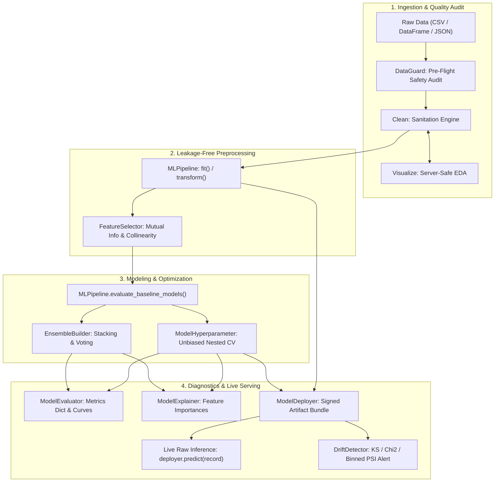

# Serverlex ⚡
**The Production-Safe Machine Learning Preprocessing, Diagnostics, & Serving Platform**

[](https://www.python.org/)
[](https://pypi.org/project/serverlex/)
[](https://github.com/Uwais-ML/Serverlex/actions)
[](https://opensource.org/licenses/MIT)
[](https://github.com/Uwais-ML/Serverlex)

**Serverlex** is an end-to-end Python library that takes raw, dirty data and transforms it into model-ready features, baseline benchmarks, tuned algorithms, and live production endpoints — with leakage-safe preprocessing (pipeline params are fit on training data only and locked at inference), train/serve parity guarantees, and cryptographically signed model artifacts.

---

## 🚀 Key Highlights & Guarantees

- **Zero Data Leakage & Auto-Remediation**: Pipeline parameters are strictly computed on training splits. `auto_remediate=True` auto-drops ID columns, PII, and target proxies ($r \ge 0.90$).
- **Turnkey FastAPI & Docker Export**: `ModelDeployer.export_api()` generates a production REST microservice with Swagger docs, Pydantic validation, and a Dockerfile in 1 line.
- **Pre-Inference Latency & SLA Profiler**: `ModelDeployer.benchmark()` calculates p50, p95, p99 latency (ms) and throughput (req/s) before deployment.
- **Standalone HTML Audit Dashboards**: `DataGuard.to_html_report()` creates a self-contained, dark-mode report with dataset Health Scores (A+ to F).
- **Production Drift Webhook Alerts**: `DriftDetector.detect_drift(alert_webhook=...)` fires automated JSON alerts to Slack/PagerDuty when population shift exceeds thresholds.
- **Collinearity & Ratio Pruning**: `FeatureSelector.prune_collinear()` removes redundant collinear duplicates while preserving features with higher predictive power.
- **Exact Train/Serve Parity**: Predict on single records (`dict`), micro-batches, or DataFrames with exact prediction equivalence and zero categorical drift.
- **Enterprise Serving Security**: Cryptographic SHA-256 sidecar verification and HMAC-SHA256 authenticity checks prevent untrusted model deserialization.

---

## 📦 Installation

Install the official package from [PyPI](https://pypi.org/project/serverlex/):

```bash
pip install serverlex
```

### Or Install Latest Development Branch:
```bash
pip install git+https://github.com/Uwais-ML/Serverlex.git
```

---

## 🏗️ End-to-End Architecture



---

## ⚡ 60-Second Quickstart

```python
import pandas as pd
from serverlex import (
    DataGuard,
    MLPipeline,
    ModelHyperparameter,
    ModelDeployer,
    DriftDetector
)

# 1. Load raw dataset
df = pd.read_csv("customers.csv")

# 2. Automated Quality Audit (catches ID columns, target leakage, class imbalance)
guard = DataGuard(df, target="churn")
audit_report = guard.run_audit(leakage_threshold=0.90, id_threshold=0.95)

# Drop detected ID / PII columns before fitting — DataGuard advises, pipeline enforces.
# MLPipeline also auto-skips ID columns internally (drop_id_cols=True by default),
# but explicit dropping here keeps your training frame clean.
cols_to_drop = [c for c in guard.id_cols if c in df.columns]
if cols_to_drop:
    df = df.drop(columns=cols_to_drop)

# 3. Fit Pipeline on Training Data (Leakage-Safe)
train_df = df.iloc[:800].copy()
test_df = df.iloc[800:].copy()

pipeline = MLPipeline()
pipeline.fit(
    train_df,
    target="churn",
    encode="onehot",
    scale="standard",
    data_time=["signup_date", "%Y-%m-%d"],
    numeric_string_cols=["monthly_bill"]
)

X_train, y_train = pipeline.transform(train_df)
X_test, y_test = pipeline.transform(test_df)

# 4. Benchmark Baseline Models (Stratified CV)
leaderboard = pipeline.evaluate_baseline_models(cv=5)

# 5. Tune Best Estimator with Nested Cross-Validation
from sklearn.ensemble import RandomForestClassifier
tuner = ModelHyperparameter()
param_grid = tuner.get_default_param_grid("random_forest")

tune_res = tuner.tune_nested_cv(
    estimator=RandomForestClassifier(random_state=42),
    param_grid=param_grid,
    X=X_train,
    y=y_train,
    outer_cv=5,
    inner_cv=3
)
best_model = tune_res["best_estimator"]

# 6. Bundle & Cryptographically Sign for Production Serving
deployer = ModelDeployer(pipeline=pipeline, model=best_model)
deployer.save("churn_bundle.joblib", compute_hash=True, hmac_key="production_secret_key")

# Later in Production: Load and predict directly on raw payload!
loaded_deployer = ModelDeployer.load("churn_bundle.joblib", hmac_key="production_secret_key")
raw_payload = {
    "signup_date": "2026-04-01",
    "monthly_bill": "$89.50",
    "device": "laptop"
}
prediction = loaded_deployer.predict(raw_payload, strict=True)
print("Predicted Churn:", prediction[0])
```

---

## 🛠️ Deep-Dive Module Guides

### 1. `serverlex.preprocessing.clean.Clean`
Robust sanitation that cleans data without corrupting valid features:
```python
from serverlex import Clean

cleaner = Clean(df)

# Cell-wise IQR outlier handling with automatic binary & target protection:
cleaned_df = cleaner.total_clean(
    outlier_method="IQR",
    outlier_param="m",           # 'm' = mean imputation, 'median' = median, 'r' = row drop
    corr_target="churn",         # Automatically excludes target from outlier clipping
    numeric_string_cols=["bill"],# Strips '$' and ',' safely
    null_threshold=0.7           # Drops columns with > 70% missing
)
```

### 2. `serverlex.diagnostics.dataguard.DataGuard`
Pre-flight health and leakage auditor:
```python
from serverlex import DataGuard

guard = DataGuard(df, target="churn")
report = guard.run_audit(leakage_threshold=0.90, id_threshold=0.95)
# Returns DataFrame with Status ('PASS', 'WARN', 'FAIL') and actionable remediation advice.
```

### 3. `serverlex.serving.deployer.ModelDeployer`
Enterprise model bundle deployer with schema auto-resilience and security:
```python
from serverlex import ModelDeployer

deployer = ModelDeployer(pipeline=pipeline, model=model)

# Cryptographic signing with SHA-256 or HMAC
deployer.save("bundle.joblib", hmac_key="secure_key")

# Safe loading (verifies authenticity before unpickling)
live_deployer = ModelDeployer.load("bundle.joblib", hmac_key="secure_key")

# Strict mode: raises ValueError on unseen categories or invalid types
preds = live_deployer.predict({"city": "Kolkata"}, strict=True)
```

### 4. `serverlex.diagnostics.drift.DriftDetector`
Finite-sample corrected distribution drift monitor:
```python
from serverlex import DriftDetector

detector = DriftDetector(reference_data=train_df, alpha=0.01, psi_threshold=0.20)
drift_report = detector.detect_drift(production_batch_df)

# Automatically guards against small sample size noise (n < 50)
# Flags missing features and constant shifts with High severity
print(drift_report[["Feature", "Type", "PSI", "Drift_Detected", "Severity"]])
```

### 5. `serverlex.diagnostics.evaluation.ModelEvaluator`
Multi-task model diagnostic engine with server-safe plotting:
```python
from serverlex import ModelEvaluator

evaluator = ModelEvaluator()
metrics = evaluator.evaluate(best_model, X_test, y_test)
# Returns structured dictionary: {"accuracy": ..., "f1_weighted": ..., "f1_macro": ..., "roc_auc": ...}

# Headless server plotting (saves file, doesn't block server)
evaluator.plot_confusion_matrix(y_test, preds, save_path="confusion_matrix.png")
```

---

## 📦 Complete Module Directory

| Subpackage | Class | Key Capabilities |
|---|---|---|
| `serverlex.preprocessing.clean` | `Clean` | Headers, deduplication, cell-wise IQR/Z-score clipping, binary protection. |
| `serverlex.preprocessing.pipeline` | `MLPipeline` | Leakage-free `fit`/`transform`, datetime extraction, encoding, scaling. |
| `serverlex.serving.deployer` | `ModelDeployer` | Pipeline-model artifact bundling, HMAC signing, strict-mode inference. |
| `serverlex.diagnostics.dataguard` | `DataGuard` | Target leakage ($r \ge 0.90$), unique ID detection, cardinality audit. |
| `serverlex.diagnostics.drift` | `DriftDetector` | Dual-significance KS, Chi-Square, Wasserstein, and binned PSI drift. |
| `serverlex.diagnostics.evaluation` | `ModelEvaluator` | Metrics dictionary return, OvR multiclass ROC, PR curve, headless plots. |
| `serverlex.diagnostics.explainability`| `ModelExplainer` | Gini importances, Permutation feature importance ranking. |
| `serverlex.modeling.selector` | `FeatureSelector` | Mutual Information feature ranking, collinearity pruning. |
| `serverlex.modeling.hyperparameter`| `ModelHyperparameter` | Non-nested `GridSearchCV` vs. unbiased Nested Cross-Validation. |
| `serverlex.modeling.ensemble` | `EnsembleBuilder` | Soft/Hard Voting and Stacking ensembles with cross-validated meta-learners. |
| `serverlex.visualization.eda` | `Visualize` | EDA plots (`save_path` support) and live `plt.ion()` interactive cleaning. |

---

## 🧪 Testing & Verification

Serverlex features a comprehensive automated test suite with **47 unit and regression tests** covering train/serve parity, outlier preservation, crypto authenticity, and drift edge cases:

```bash
# Run the test suite:
pytest -v tests/
```

Reproduce real-world benchmark assertions:
```bash
python benchmarks/reproduce_benchmarks.py
```

---

## 🏆 Real-World Validation

Serverlex has been validated on benchmark datasets:

- **Customer Churn (`muhammadshahidazeem/customer-churn-dataset`)**:
  - `DataGuard` correctly flagged `CustomerID` as a 100% unique identifier and excluded it from encoding.
  - Cell-wise outlier clipping preserved `churn` distribution with zero label alteration.
  - Cross-validated accuracy on clean data (no ID leakage): results vary by CV split and hyperparameters — benchmark on your own data.
- **Walmart Store Sales (`mikhail1681/walmart-sales`)**:
  - Extracted temporal features from dates (`year`, `month`, `day`, `dayofweek`).
  - Random Forest Regressor trained to **$R^2 = 0.9455$** ($\text{RMSE} = 133{,}727$).

---

## 📄 License

Serverlex is licensed under the [MIT License](LICENSE).
