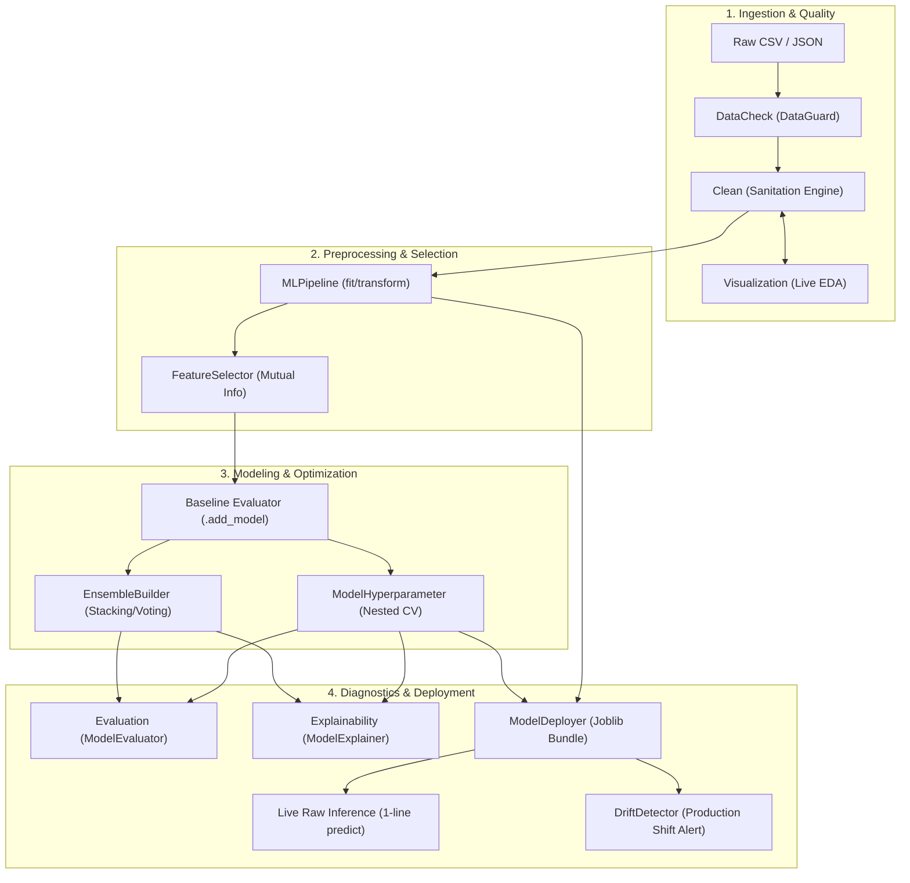

# Serverlex ⚡
**The Production-Safe Machine Learning Preprocessing, Diagnostics, & Serving Platform**

[](https://www.python.org/)
[](https://pypi.org/project/serverlex/)
[](https://pypi.org/project/serverlex/)
[](https://opensource.org/licenses/MIT)
[](https://github.com/Uwais-ML/Serverlex)

**Serverlex** is an end-to-end Python library that takes raw, dirty data and transforms it into model-ready features, baseline benchmarks, tuned algorithms, and live production endpoints—all without data leakage or boilerplate code.

---

## 📦 Installation

Install the official release directly from [PyPI](https://pypi.org/project/serverlex/):

```bash
pip install serverlex
```

### Or Install From Source / GitHub:
```bash
# Latest development branch from GitHub:
pip install git+https://github.com/Uwais-ML/Serverlex.git

# Or clone and install in editable mode:
git clone https://github.com/Uwais-ML/Serverlex.git
cd Serverlex
pip install -e .
```

---

## 🏗️ Architecture



---

## ⚡ 60-Second Quickstart

```python
import pandas as pd
from serverlex import (
    DataGuard,
    MLPipeline,
    ModelHyperparameter,
    ModelExplainer,
    ModelDeployer
)

# 1. Load Raw Messy Data
df = pd.read_csv("customers.csv")

# 2. Automated Quality Audit (catches ID columns, target leakage, class imbalance)
guard = DataGuard(df)
guard.run_audit(target="churn")

# 3. Fit Pipeline on Training Data (Zero Data Leakage)
train_df = df.iloc[:800].copy()
test_df = df.iloc[800:].copy()

pipeline = MLPipeline()
pipeline.fit(
    train_df,
    target="churn",
    encode="onehot",
    scale="standard",
    data_time=["signup_date", "%Y-%m-%d"],
    numeric_string_cols=["monthly_bill"]
)

X_train, y_train = pipeline.transform(train_df)
X_test, y_test = pipeline.transform(test_df)

# 4. Benchmark Baseline Models (+ add custom ones)
pipeline.evaluate_baseline_models(X_train, y_train, cv=5)

# 5. Tune Best Model with Unbiased Nested Cross-Validation
from sklearn.ensemble import RandomForestClassifier
tuner = ModelHyperparameter()
param_grid = tuner.get_default_param_grid("random_forest")

tune_res = tuner.tune_nested_cv(
    estimator=RandomForestClassifier(random_state=42),
    param_grid=param_grid,
    X=X_train,
    y=y_train,
    outer_cv=5,
    inner_cv=3
)
best_model = tune_res["best_estimator"]

# 6. Model Explainability
explainer = ModelExplainer(best_model, X_train.columns)
print(explainer.get_feature_importances().head(5))

# 7. Bundle & Deploy for Production Serving
deployer = ModelDeployer(pipeline=pipeline, model=best_model)
deployer.save("churn_deployer.joblib")

# Later in production: Predict directly on raw incoming JSON / dict!
loaded_deployer = ModelDeployer.load("churn_deployer.joblib")
raw_input = {"signup_date": "2026-04-01", "monthly_bill": "$89.50", "device": "laptop"}
print("Predicted Churn:", loaded_deployer.predict(raw_input)[0])
```

---

## 📦 Core Module Reference

| Module | Core Class | Primary Purpose |
|---|---|---|
| [`Clean.py`](Clean.py) | `Clean` | Headers, deduplication, IQR/Z-score outlier capping, format parsing. |
| [`DataCheck.py`](DataCheck.py) | `DataGuard` | Pre-training safety audit (ID detection, target leakage, class imbalance). |
| [`Visualization.py`](Visualization.py) | `Visualize` | EDA plots (missing, distribution, box, correlation) and real-time `plt.ion()`. |
| [`Pipeline.py`](Pipeline.py) | `MLPipeline` | Leakage-free `fit`/`transform`, datetime extraction, encoding, scaling. |
| [`FeatureSelector.py`](FeatureSelector.py) | `FeatureSelector` | Mutual Information ranking, collinearity pruning, variance threshold. |
| [`ModelHyperparameter.py`](ModelHyperparameter.py) | `ModelHyperparameter` | Non-nested `GridSearchCV` and unbiased Nested Cross-Validation. |
| [`EnsembleBuilder.py`](EnsembleBuilder.py) | `EnsembleBuilder` | Soft/Hard Voting and Stacking ensembles with meta-learners. |
| [`Evaluation.py`](Evaluation.py) | `ModelEvaluator` | Confusion matrix, ROC-AUC, PR curves, and regression residuals. |
| [`Explainability.py`](Explainability.py) | `ModelExplainer` | Native tree feature importances & permutation importance. |
| [`ModelDeployer.py`](ModelDeployer.py) | `ModelDeployer` | Pipeline-model artifact bundling and 1-line prediction on raw data. |
| [`DriftDetector.py`](DriftDetector.py) | `DriftDetector` | Kolmogorov-Smirnov (numbers) and Chi-Square (categories) drift tests. |

---

## 🏆 Real-World Kaggle Benchmarks

Serverlex was verified on real-world Kaggle datasets without custom code changes:

- **Customer Churn (`muhammadshahidazeem/customer-churn-dataset`)**:
  - `DataGuard` detected `CustomerID` as 100% unique ID and recommended removal.
  - Baseline Gradient Boosting achieved **99.42% accuracy**.
  - `ModelExplainer` identified `support_calls` (0.277) and `total_spend` (0.235) as top drivers.
  
- **Walmart Sales (`mikhail1681/walmart-sales`)**:
  - Extracted cyclical features from date strings (`year`, `month`, `day`, `dayofweek`).
  - Auto-detected regression and trained Random Forest Regressor to **$R^2 = 0.9455$** ($\text{RMSE} = 133,727$).

---

## 🛠️ Installation

```bash
# Clone and install in editable development mode:
git clone https://github.com/your-username/Serverlex.git
cd Serverlex
pip install -e .
```

---

## 📖 In-Depth Manual

For mathematical concepts, parameter references, and output walkthroughs for every module, see **[`DOCUMENTATION.md`](DOCUMENTATION.md)**.
