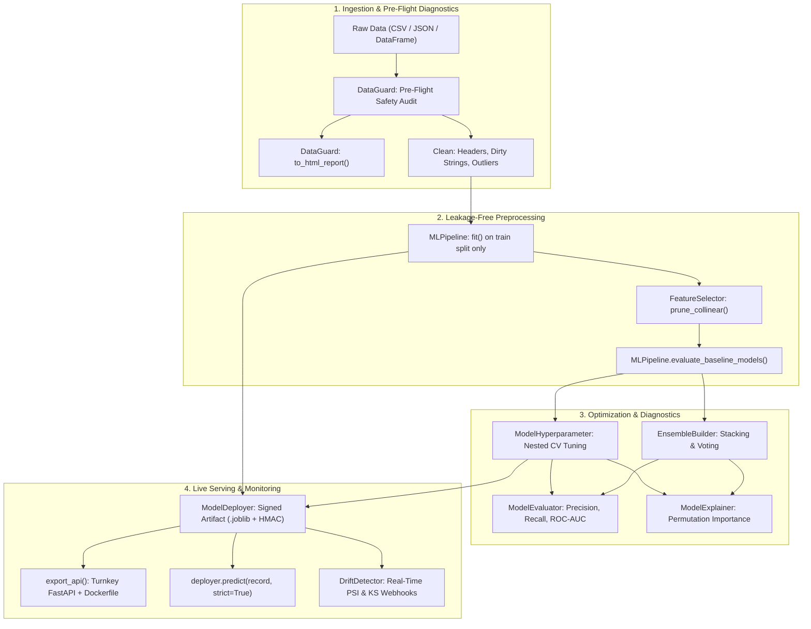

# Serverlex ⚡
**The Production-Safe Machine Learning Preprocessing, Diagnostics, & Serving Platform**

[](https://pypi.org/project/serverlex/)
[](https://www.python.org/)
[](https://opensource.org/licenses/MIT)
[](https://github.com/Uwais-ML/Serverlex/actions)
[](https://github.com/Uwais-ML/Serverlex)

---

**Serverlex** is an end-to-end Python library that takes raw, dirty data and transforms it into model-ready features, baseline benchmarks, tuned algorithms, and live production endpoints. It provides **mathematical leakage protection**, automated **pre-flight data auditing**, **train/serve parity guarantees**, and **cryptographically secured microservice exports**.

---

## 📌 Table of Contents

- [Key Highlights & Guarantees](#-key-highlights--guarantees)
- [Installation](#-installation)
- [Architecture](#-architecture)
- [60-Second Quickstart](#-60-second-quickstart)
- [Core Modules & Code Examples](#-core-modules--code-examples)
  - [1. DataGuard: Data Quality & Leakage Auditor](#1-dataguard-pre-flight-health--leakage-auditing)
  - [2. Clean: Outlier & Dirty Data Sanitizer](#2-clean-data-sanitization--outlier-engine)
  - [3. MLPipeline: Leakage-Safe Feature Pipeline](#3-mlpipeline-leakage-free-preprocessing)
  - [4. FeatureSelector: Collinear Cluster Pruning](#4-featureselector-collinear-cluster-pruning)
  - [5. ModelDeployer: Hardened FastAPI & Docker Serving](#5-modeldeployer-hardened-fastapi--docker-serving)
  - [6. ModelEvaluator: Diagnostic Metrics & Curves](#6-modelevaluator-multi-task-evaluation)
  - [7. ModelExplainer: Permutation Feature Importance](#7-modelexplainer-held-out-permutation-importance)
  - [8. DriftDetector: Production Distribution Shift & Webhooks](#8-driftdetector-production-drift-monitoring--webhooks)
  - [9. ModelHyperparameter: Unbiased Nested CV Tuning](#9-modelhyperparameter-nested-cv-tuning)
  - [10. EnsembleBuilder: Stacking & Voting Classifiers](#10-ensemblebuilder-stacking--voting-ensembles)
  - [11. Visualize: Headless Server-Safe EDA Plots](#11-visualize-headless-server-safe-eda)
- [Live Inference & Serving Guide](#-live-inference--serving-guide)
- [Running Tests](#-running-tests)
- [License](#-license)

---

## 🚀 Key Highlights & Guarantees

- **Zero Data Leakage**: Pipeline parameters (scaling means, standard deviations, categorical levels, imputation medians) are strictly computed on training splits and locked at inference time.
- **Automated Pre-Flight Auditing (`DataGuard`)**: Detects 100% unique ID columns, target proxies ($|r| \ge 0.90$), PII columns, infinite values, and severe class imbalance before training starts.
- **Cluster-Based Collinearity Pruning (`FeatureSelector`)**: Eliminates redundant collinear pairs while preserving the most predictive features using Mutual Information and signed difference analysis.
- **Turnkey FastAPI & Docker Microservices (`ModelDeployer`)**: Exports a full REST serving API with Swagger documentation, Pydantic validation, and a Dockerfile in 1 line of code.
- **Enterprise Artifact Security**: Built-in HMAC-SHA256 cryptographic signatures prevent untrusted or tampered model bundle deserialization.
- **Pre-Inference Latency & SLA Profiler**: Benchmark p50, p95, p99 latency (ms) and throughput (req/s) directly inside Python.
- **Real-Time Drift Webhook Alerts (`DriftDetector`)**: Monitors live production batches against baseline training data using Population Stability Index (PSI) and Kolmogorov-Smirnov (KS) tests, firing automated alerts to Slack or PagerDuty.

---

## 📦 Installation

Install the official package from [PyPI](https://pypi.org/project/serverlex/):

```bash
pip install serverlex
```

### Install with Developer Dependencies:
```bash
pip install serverlex[dev]
```

---

## 🏗️ Architecture



---

## ⚡ 60-Second Quickstart

Here is a complete, runnable end-to-end example demonstrating audit, cleaning, pipeline fitting, evaluation, and signed model export:

```python
import pandas as pd
from sklearn.ensemble import RandomForestClassifier
from serverlex import (
    DataGuard,
    MLPipeline,
    ModelEvaluator,
    ModelDeployer
)

# 1. Load raw data
df = pd.read_csv("customers.csv")

# 2. Pre-flight safety audit & auto-remediation
guard = DataGuard(df, target="churn")
guard.run_audit()
clean_df, summary = guard.auto_remediate(
    target="churn",
    drop_ids=True,
    drop_leakage=True,
    drop_pii=True
)
print("Auto-remediated columns:", summary["dropped_columns"])

# 3. Train/Test split
train_df = clean_df.iloc[:800].copy()
test_df = clean_df.iloc[800:].copy()

# 4. Leakage-free pipeline fitting
pipe = MLPipeline()
X_train, y_train = pipe.fit_transform(
    train_df,
    target="churn",
    encode="onehot",
    scale="standard",
    data_time=["signup_date", "%Y-%m-%d"],
    numeric_string_cols=["monthly_bill"]  # Automatically parses currency like '$89.50'
)
X_test, y_test = pipe.transform(test_df)

# 5. Train model & evaluate
model = RandomForestClassifier(n_estimators=100, random_state=42)
model.fit(X_train, y_train)

evaluator = ModelEvaluator(model=model, X_test=X_test, y_test=y_test)
metrics = evaluator.evaluate()
print(f"Accuracy: {metrics['accuracy']:.4f} | ROC-AUC: {metrics['roc_auc']:.4f}")

# 6. Save & sign production artifact bundle
deployer = ModelDeployer(pipeline=pipe, model=model)
deployer.save("churn_model.joblib", compute_hash=True, hmac_key="production-secret-key")

# 7. Predict directly on a single raw JSON record!
sample_input = {
    "signup_date": "2024-05-15",
    "monthly_bill": "$92.40",
    "device": "laptop",
    "tenure_months": 14,
    "support_tickets": 2
}
prediction = deployer.predict(sample_input, strict=True)
print("Predicted Churn:", prediction[0])
```

---

## 🛠️ Core Modules & Code Examples

### 1. `DataGuard`: Pre-Flight Health & Leakage Auditing

`DataGuard` audits raw datasets for data hygiene risks before model training:

```python
from serverlex import DataGuard

guard = DataGuard(df, target="churn")

# Run comprehensive diagnostic audit
report = guard.run_audit(leakage_threshold=0.90, id_threshold=0.95)

# Inspect findings
print("Detected ID Columns:", guard.id_cols)
print("Detected Target Leakage:", guard.leakage_cols)
print("Detected PII Columns:", guard.pii_cols)
print("Collinear Pairs (|r| >= 0.85):", guard.collinear_pairs)

# Generate an interactive, self-contained HTML audit dashboard
guard.to_html_report("audit_dashboard.html")

# Auto-remediate flagged columns in one call
clean_df, summary = guard.auto_remediate(target="churn")
```

---

### 2. `Clean`: Data Sanitization & Outlier Engine

Sanitize messy values, handle extreme outliers, and coerce currency strings:

```python
from serverlex import Clean

cleaner = Clean(df)

# Inspect separated column types
types = cleaner.separate()
print("Numeric:", types["numeric"])
print("Categorical:", types["categorical"])
print("Datetime:", types["datetime"])

# Clean dirty strings, handle IQR outliers, and impute medians
cleaned_df = cleaner.total_clean(
    numeric_string_cols=["monthly_bill", "total_paid"],  # Coerces '$1,200.50' -> 1200.50
    missing_param="md",                                  # 'md' = median, 'm' = mean, 'z' = zero
    outlier_method="IQR",                                # Outlier clipping using 1.5 * IQR
    null_threshold=0.70                                  # Drops columns with > 70% missing
)
```

---

### 3. `MLPipeline`: Leakage-Free Preprocessing

Encapsulates preprocessing logic, locking training parameters to eliminate train/serve skew:

```python
from serverlex import MLPipeline

pipeline = MLPipeline()

# Fit strictly on training split
X_train, y_train = pipeline.fit_transform(
    train_df,
    target="churn",
    encode="onehot",                         # 'onehot', 'label', 'target', or 'none'
    scale="standard",                        # 'standard', 'minmax', 'robust', or 'none'
    drop_pii=True,                           # Automatically drops high-cardinality PII
    auto_remediate=True,                     # Drops detected ID columns & leakage proxies
    data_time=["signup_date", "%Y-%m-%d"],   # Expands to year, month, day, dayofweek
    numeric_string_cols=["monthly_bill"]
)

# Transform test data using frozen training parameters
X_test, y_test = pipeline.transform(test_df)

# Quick multi-model baseline leaderboard with 5-fold cross-validation
leaderboard = pipeline.evaluate_baseline_models(cv=5)
print(leaderboard)
```

---

### 4. `FeatureSelector`: Collinear Cluster Pruning

Standard pairwise collinearity filters can delete entire groups of correlated features. Serverlex uses **connected-component clustering** with Mutual Information to guarantee that exactly one optimal representative survives:

```python
from serverlex import FeatureSelector

# Prune collinear features while preserving predictive signal
pruned_X, dropped_features = FeatureSelector.prune_collinear(
    X_train,
    threshold=0.85,
    y=y_train  # Passing y preserves features with higher mutual information with the target
)

print(f"Dropped redundant features: {dropped_features}")
print(f"Kept features: {list(pruned_X.columns)}")
```

---

### 5. `ModelDeployer`: Hardened FastAPI & Docker Serving

Export a production REST API microservice in one command:

```python
from serverlex import ModelDeployer

deployer = ModelDeployer(pipeline=pipeline, model=model)

# 1. Export ready-to-run FastAPI + Docker microservice
export_info = deployer.export_api(
    output_dir="./serving_service",
    bundle_filename="model_bundle.joblib",
    hmac_key="production_secret_key",
    host="0.0.0.0",
    port=8000
)

# 2. Benchmark pre-inference latency SLA
sla = deployer.benchmark(sample=sample_dict, n_iterations=300, warmup=20)
print(f"P50: {sla['p50_ms']:.2f}ms | P95: {sla['p95_ms']:.2f}ms | Throughput: {sla['throughput_req_per_sec']:.1f} req/s")

# 3. Custom probability decision thresholding
predictions = deployer.predict(sample_dict, threshold=0.35, strict=True)
```

---

### 6. `ModelEvaluator`: Multi-Task Evaluation

Compute structured metrics and plot diagnostic curves:

```python
from serverlex import ModelEvaluator

evaluator = ModelEvaluator(model=model, X_test=X_test, y_test=y_test)

# Comprehensive metrics dictionary
metrics = evaluator.evaluate()
print("Metrics:", metrics)

# Classification report as a clean Pandas DataFrame
report_df = evaluator.classification_report_df()
print(report_df)

# Headless server plotting (saves image, non-blocking)
evaluator.plot_confusion_matrix(y_test, predictions, save_path="confusion_matrix.png")
evaluator.plot_roc_curve(y_test, probabilities, save_path="roc_curve.png")
```

---

### 7. `ModelExplainer`: Held-Out Permutation Importance

Gini tree importance is notoriously biased toward high-cardinality features. Permutation importance on unseen test data evaluates genuine feature power:

```python
from serverlex import ModelExplainer

explainer = ModelExplainer(model=model, feature_names=list(X_train.columns))

# Compute permutation feature importance on held-out test split
perm_df = explainer.compute_permutation_importance(X_test, y_test, n_repeats=10)

# Displays: ['Feature', 'Permutation_Importance_Mean', 'Permutation_Importance_Std']
print(perm_df.head(10))
```

---

### 8. `DriftDetector`: Production Drift Monitoring & Webhooks

Monitor live incoming data against training baselines to detect population shift:

```python
from serverlex import DriftDetector

detector = DriftDetector(
    reference_data=X_train,
    threshold=0.25,                                           # PSI drift threshold
    webhook_url="https://hooks.slack.com/services/ALERT_URL",  # Automated Slack notification
    raise_on_drift=False
)

# Detect drift on live inference batch
drift_report = detector.detect_drift(live_production_df)

if drift_report["drift_detected"]:
    print("Alert! Drift detected in features:", drift_report["drifted_features"])
    print(drift_report[["Feature", "PSI", "Drift_Detected", "Severity"]])
```

---

### 9. `ModelHyperparameter`: Nested CV Tuning

Perform unbiased hyperparameter tuning using nested cross-validation to prevent optimistic performance bias:

```python
from serverlex import ModelHyperparameter
from sklearn.ensemble import RandomForestClassifier

tuner = ModelHyperparameter()
param_grid = tuner.get_default_param_grid("random_forest")

tuning_result = tuner.tune_nested_cv(
    estimator=RandomForestClassifier(random_state=42),
    param_grid=param_grid,
    X=X_train,
    y=y_train,
    outer_cv=5,
    inner_cv=3,
    scoring="roc_auc"
)

best_model = tuning_result["best_estimator"]
print(f"Unbiased Nested CV Score: {tuning_result['nested_score']:.4f}")
print("Best Parameters:", tuning_result["best_params"])
```

---

### 10. `EnsembleBuilder`: Stacking & Voting Ensembles

Combine diverse classifiers or regressors to boost generalization:

```python
from serverlex import EnsembleBuilder
from sklearn.ensemble import RandomForestClassifier, GradientBoostingClassifier
from sklearn.linear_model import LogisticRegression

builder = EnsembleBuilder(
    estimators=[
        ("rf", RandomForestClassifier(n_estimators=100, random_state=42)),
        ("gb", GradientBoostingClassifier(n_estimators=100, random_state=42))
    ],
    final_estimator=LogisticRegression(),
    voting="soft"
)

# Build Stacking Classifier with internal cross-validated predictions
stacking_clf = builder.build_stacking_classifier(cv=5)
stacking_clf.fit(X_train, y_train)

# Or build Voting Classifier
voting_clf = builder.build_voting_classifier()
voting_clf.fit(X_train, y_train)
```

---

### 11. `Visualize`: Headless Server-Safe EDA

Generate exploratory data analysis visualizations in headless CI/CD and server environments without display servers:

```python
from serverlex import Visualize

viz = Visualize(df)

# Missing value heatmap
viz.plot_missing(save_path="eda_missing.png")

# Feature distributions
viz.plot_distribution("monthly_bill", save_path="eda_dist.png")

# Correlation matrix heatmap
viz.plot_correlation(save_path="eda_correlation.png")

# Outlier boxplots
viz.plot_box("tenure_months", save_path="eda_box.png")
```

---

## 📡 Live Inference & Serving Guide

When you export your serving microservice via `ModelDeployer.export_api()`:

```bash
cd serving_service

# 1. Provide the HMAC verification secret
export SERVERLEX_HMAC_KEY="production_secret_key"

# 2. Run with Uvicorn
uvicorn app:app --host 0.0.0.0 --port 8000
```

### Querying the Live Endpoints

#### Health Check
```bash
curl -s http://localhost:8000/health
```
```json
{
  "status": "healthy",
  "service": "serverlex-serving",
  "model": "RandomForestClassifier",
  "feature_count": 10
}
```

#### Live Prediction (Strict Mode)
Rejects invalid categories or missing keys with HTTP 400:
```bash
curl -X POST "http://localhost:8000/predict" \
     -H "Content-Type: application/json" \
     -d '{
       "monthly_bill": "$89.50",
       "tenure_months": 12,
       "support_tickets": 1,
       "signup_date": "2024-03-01",
       "device": "laptop"
     }'
```
```json
{
  "predictions": [0]
}
```

#### Custom Decision Threshold
```bash
curl -X POST "http://localhost:8000/predict?threshold=0.35" \
     -H "Content-Type: application/json" \
     -d '{"monthly_bill": "$89.50", "tenure_months": 12, "support_tickets": 4, "signup_date": "2024-03-01", "device": "laptop"}'
```

#### Latency SLA Benchmark
```bash
curl -s "http://localhost:8000/benchmark?n_samples=200"
```

---

## 🧪 Running Tests

Serverlex includes a rigorous test suite of **47 internal tests** and **33 regression/hardening tests**:

```bash
# Run internal test suite
pytest tests/ -v

# Run real-world benchmark validations
python benchmarks/reproduce_benchmarks.py
```

---

## 📄 License

Serverlex is licensed under the [MIT License](LICENSE).
